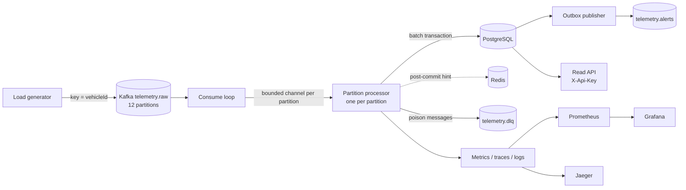

# Telemetry Core

A .NET 8 proof of concept that ingests high-volume vehicle fleet telemetry from Kafka into PostgreSQL with
**per-vehicle ordering, no loss, no double counting and crash safety**. It includes a resilience layer, a
transactional outbox, a read API, full observability, Docker Compose and Kubernetes/KEDA manifests.

## The problem

A fleet sends position and speed events continuously. The pipeline must:

- keep the order of events of each vehicle (out-of-order and GPS-jump detection depend on it);
- never lose an event, even when the worker, database, Redis or Kafka fails;
- never count an event twice, even though Kafka delivers at-least-once and producers resend;
- raise alerts (for example speeding): persisted exactly once per triggering event, published to Kafka at-least-once;
- keep up with load, and show a lag/backpressure signal instead of dropping data.

## Architecture



ASCII fallback:

```
generator -> Kafka telemetry.raw (key = vehicleId, 12 partitions)
          -> consume loop -> bounded channel per partition -> one processor per partition
          -> batch transaction in PostgreSQL (events, state, alerts, outbox)
          -> outbox publisher -> Kafka telemetry.alerts
   poison messages -> telemetry.dlq        Redis = post-commit hint only
   PostgreSQL -> Read API (X-Api-Key)      metrics -> Prometheus -> Grafana, traces -> Jaeger
```

More detail in [docs/ARCHITECTURE.md](docs/ARCHITECTURE.md).

## Key features

- Per-vehicle ordering: Kafka key = vehicle id, one processor per partition.
- Idempotency by the database primary key on `processed_events`; Redis is only a hint (D1).
- Batch transactions: events, vehicle state, alerts and outbox rows commit together.
- Offsets stored only after the DB commit (and DLQ publish).
- Business rules: out-of-order detection, GPS jumps, daily distance, speeding alerts.
- Resilience (Polly): retry with jitter, circuit breaker, timeouts, bulkhead; backpressure through bounded channels.
- Transactional outbox for alert publishing (at-least-once).
- Dead-letter topic for invalid messages.
- Read API (`/vehicles/{vehicleId}/state`, `/alerts`) with API-key auth, rate limiting and a read-only DB role.
- Observability: Prometheus metrics, OpenTelemetry traces with span links, structured logs, Grafana dashboard.
- Graceful shutdown; Docker Compose stack; Kubernetes manifests with KEDA lag-based autoscaling.

## Quick start

Prerequisites: .NET 8 SDK or newer, Docker Desktop, git.

```powershell
scripts\up.ps1                    # builds and starts the whole stack (Docker Compose)
scripts\demo.ps1 -Total 100000    # load with injected faults, then checks the numbers
scripts\down.ps1                  # stop (add -Purge to delete the database volume)
```

Linux/macOS: `./scripts/up.sh`, `./scripts/demo.sh --total 100000`, `./scripts/down.sh`.
The first `up` creates `.env` from `.env.example` (local demo values only).

| Service | URL |
|---|---|
| Grafana | http://localhost:3000 |
| Prometheus | http://localhost:9090 |
| Jaeger | http://localhost:16686 |
| Read API | http://localhost:8080 (send the `X-Api-Key` header; local value in `.env`, `TELEMETRY_API_KEY`) |
| Worker metrics | http://localhost:8081/metrics (health: `/health/live`, `/health/ready`) |

Example: `curl -H "X-Api-Key: <key>" http://localhost:8080/alerts`

## Testing

```powershell
dotnet test TelemetryCore.sln        # unit + integration (integration needs Docker running)
scripts\demo.ps1                     # end-to-end load demo, prints PASS only if every number matches
scripts\chaos.ps1 -Scenario kill     # failure scenarios: kill | postgres | redis | rebalance
scripts\verify-security.ps1          # container hardening and secret checks
scripts\verify-infra.ps1             # smoke check of topics, Redis, Postgres roles
```

Details in [docs/TESTING.md](docs/TESTING.md).

## Measured results

Local laptop measurements, single-node Kafka, one worker replica. Not a benchmark. Raw outputs are written under `artifacts/` by the scripts.

| Metric | Value |
|---|---|
| Machine | 8 logical CPUs, 15.4 GB RAM, Windows 11; Docker Desktop limited to 8 CPUs / 7.5 GB |
| Events sent | 100,000 and 1,000,000 (`scripts\demo.ps1 -Total ...`), both PASS |
| Processing throughput (events/s) | peak 6,955 (100k run), 6,864 (1M run); generator produced 14,760 / 18,458 events/s |
| p95 processing latency (event timestamp to persisted) | 18.8 s (100k), 30 s = histogram ceiling (1M). Dominated by queueing: the generator produces 2.1-2.7x faster than one worker persists, so events wait in Kafka (max lag 88,551 / 850,717) |
| p95 batch duration | 0.88 s (100k), 0.60 s (1M) |
| Duplicates detected vs injected | 2,000 / 2,000 (100k); 20,000 / 20,000 (1M) |
| Out-of-order detected vs injected | 1,000 / 1,000 (100k); 10,000 / 10,000 (1M) |
| DLQ messages vs invalid injected | 500 / 500 (100k); 5,000 / 5,000 (1M, 1,000 per reason) |
| Recovery after worker kill (`docker kill -s KILL`, 100k) | PASS: 97,500 / 97,500 unique rows, none lost or duplicated; lag 49,751 while down, 0 about 55 s after the restart |
| Recovery after DB outage (PostgreSQL stopped 20 s, 100k) | PASS: 97,500 / 97,500 unique rows; lag held at 59,901 during the outage (backpressure, nothing dropped) and reached 0 about 27 s after PostgreSQL started. The breaker gauge sampled by Prometheus stayed at 0 (closed), so circuit opening was not observed in this run |

## Design decisions

All in [docs/DECISIONS.md](docs/DECISIONS.md). Highlights:

- The database is the source of truth for idempotency; Redis is only a post-commit hint (D1).
- Rules run on working copies; memory is updated only after commit (D5).
- Offsets stored after DB commit, with periodic client commit (D9); partition revoke drains synchronously (D10).
- Batches are kept and retried while the circuit is open, producing backpressure (D11).
- Least-privilege DB users (D13); traces in Jaeger with span links (D14); lag from `kafka-exporter` (D15).
- Raw Npgsql with `unnest` in the worker, Dapper in the Read API (D20).
- `COMMIT` has no attempt timeout; failed commits evict cache state (D21, D22).
- Outbox cancels a batch only on broker-unavailable errors (D24).
- Kubernetes shutdown budget and KEDA ceiling (D28).

## Limitations

- Single-node Kafka (KRaft) and single Postgres; no replication or failover is demonstrated.
- Measurements come from a local laptop and are not representative of production.
- API-key authentication only; there is no real identity provider.
- The DLQ is at-least-once (D17); duplicates in the DLQ are possible.
- A database outage longer than `max.poll.interval.ms` (5 min) triggers a rebalance (D11); pausing partitions would be the next step.
- Poison outbox rows are retried forever (no outbox DLQ or attempt limit).
- Kubernetes manifests were validated offline but not run on a cluster.
- Only the `SPEEDING` alert is implemented.
- The Compose worker publishes a fixed host port (8081), so `--scale worker=2` fails; rebalance is tested in-process (`ResilienceTests`) and in Kubernetes via KEDA replicas.
- Latency under backlog: one worker persists ~6.9k events/s; when producers are faster, p95 latency reflects time queued in Kafka (30 s histogram ceiling in the 1M run).

## Repository structure

```
src/
  TelemetryCore.Contracts/      DTOs, topic names, headers
  TelemetryCore.Domain/         validation and business rules (no I/O)
  TelemetryCore.Worker/         ingestion, persistence, resilience, outbox, observability
  TelemetryCore.ReadApi/        read endpoints, API-key middleware
  TelemetryCore.LoadGenerator/  fleet simulator with fault injection
tests/
  TelemetryCore.Domain.Tests/ Worker.Tests/ LoadGenerator.Tests/ IntegrationTests/
db/                             roles and schema (init scripts)
deploy/
  docker-compose.yml  prometheus/  grafana/  k8s/
scripts/                        up, down, demo, chaos, verify-infra, verify-security
docs/                           ARCHITECTURE.md, TESTING.md, DECISIONS.md
SPEC.md
```

## License

[MIT](LICENSE)
