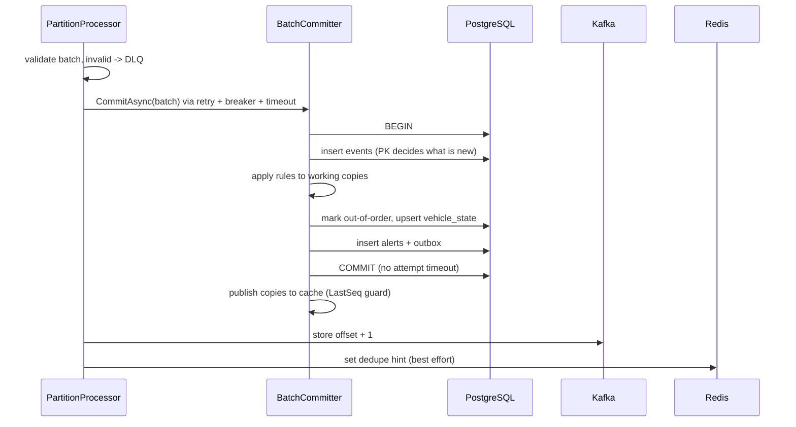

# Architecture

## Components

| Component | Project | Role |
|---|---|---|
| Worker | `src/TelemetryCore.Worker` | Consumes `telemetry.raw`, validates, applies rules, writes to PostgreSQL, publishes DLQ and alerts |
| Domain | `src/TelemetryCore.Domain` | `EventValidator`, `TelemetryRules`, `VehicleState`, `Geo` (pure, no I/O) |
| Contracts | `src/TelemetryCore.Contracts` | DTOs, `Topics`, Kafka header names |
| Read API | `src/TelemetryCore.ReadApi` | `GET /vehicles/{vehicleId}/state`, `GET /alerts`, health endpoints, `X-Api-Key` middleware, rate limiter (100 requests per 10 s window) |
| Load generator | `src/TelemetryCore.LoadGenerator` | Simulated fleet with duplicates, out-of-order and invalid events |
| PostgreSQL | `db/001_init.sql` | `processed_events`, `vehicle_state`, `alerts`, `outbox`; roles `telemetry_worker` and `telemetry_reader` (D13) |
| Kafka | compose | Topics `telemetry.raw` (12 partitions), `telemetry.dlq` (3), `telemetry.alerts` (3) |
| Redis | compose | Dedupe hint only |

## Data flow

1. Producers publish to `telemetry.raw` with the vehicle id as key, so one vehicle always lands on one partition.
2. `IngestionService` consumes and routes each message to a bounded channel (`ChannelCapacity` 1000) of its partition.
3. One `PartitionProcessor` per partition reads its channel, groups messages into batches (`BatchSize` 500 or `FlushInterval` 100 ms), validates them (invalid ones go to the DLQ) and commits the rest through `ResilientBatchCommitter`.
4. `BatchCommitter` writes one transaction. After commit, offsets are stored and the Redis hint is set.
5. Alerts are written to the `outbox` table in the same transaction; `OutboxPublisher` publishes them to `telemetry.alerts`.
6. The Read API reads `vehicle_state` and `alerts` with a read-only role.

## Concurrency model

- One consume loop reads from Kafka and writes into the channel of the message's partition.
- Each partition has a bounded channel and exactly one processor, so processing inside a partition is sequential by construction.
- Backpressure: when the database is slow or the circuit is open, the processor keeps its batch and retries (D11). The channel fills, the consume loop waits on the full channel, and Kafka lag grows. Nothing is dropped.
- On partition revoke the partition is drained synchronously before the handler returns (D10), and its vehicles are evicted from memory.

## Batch commit sequence

1. Insert events; the primary key tells which are new.
2. Run rules on working copies of the touched vehicles, in batch order.
3. Upsert state, alerts and outbox rows.
4. COMMIT.
5. Update the in-memory cache and store offsets (`enable.auto.offset.store=false`, D9).
6. Set the Redis hint.

## Offsets and idempotency

Kafka gives at-least-once: after a crash the worker re-reads everything after the last stored offset. Because offsets are stored only after the DB commit, no event is lost. A re-read event hits the primary key of `processed_events`, is not "new", and changes nothing; counters count only new rows. At-least-once delivery plus an idempotent key gives effectively-once results.

Redis cannot be the source of truth: a `SET` before the commit could mark an event as seen when the transaction later fails, so it would be dropped on retry. Redis is therefore written only after the commit and is used only to skip work early; if it is down or wrong, the database decides (the R2 correction, D1). A Redis failure only increments `telemetry_redis_fallback_total`.

Failed or ambiguous commits evict the batch's vehicles from the cache, and the cache accepts only newer state (D22).

## Failure modes

| Failure | Behavior |
|---|---|
| Worker killed | Unstored offsets are re-read after restart; the primary key discards duplicates. No loss, no double count. |
| Database down | Retry (3x, jitter), then the circuit opens (50 % failures); the processor keeps its batch, channels fill, lag grows (backpressure). Recovers when the circuit closes. Outage > 5 min triggers a rebalance. |
| Redis down | Calls time out after 200 ms and fall back to the database; `telemetry_redis_fallback_total` grows. |
| Kafka down | Consume loop waits; the outbox leaves rows pending and cancels the publish batch on broker-unavailable errors (D24); resumes when the broker returns. |
| Poison message | Sent to `telemetry.dlq` with a reason before the offset is stored (at-least-once, D17). |
| Rebalance | Partition drained synchronously, offsets committed, vehicles evicted; the new owner reloads state from the DB. |

## Observability

Meter `TelemetryCore.Worker`, exposed at `:8081/metrics`:

- Counters (exposed with the `_total` suffix): `telemetry_events_consumed`, `telemetry_events_processed`, `telemetry_duplicates`, `telemetry_out_of_order`, `telemetry_dlq`, `telemetry_alerts_raised`, `telemetry_gps_jumps`, `telemetry_redis_fallback`
- Histograms: `telemetry_processing_latency_seconds`, `telemetry_batch_duration_seconds`
- Gauges: `telemetry_circuit_breaker_state`, `telemetry_channel_depth`
- Consumer lag comes from `kafka-exporter` (D15).

Traces: OpenTelemetry source `TelemetryCore.Worker`, exported to Jaeger. A batch span carries links to the producer trace contexts (`traceparent` Kafka header), with child spans such as `db.write` per attempt (D14).

Logs: structured Serilog output.

The Grafana dashboard `deploy/grafana/dashboards/telemetry-core.json` has panels: Events/s, p95 processing latency, p95 batch duration, Consumer lag, Channel depth by partition, Circuit breaker state, Duplicates (total and per second), DLQ by reason, Out-of-order, Alerts raised, Redis fallbacks, GPS jumps.

## Deployment

- Docker Compose: `deploy/docker-compose.yml` (Kafka, Redis, Postgres, worker, read-api, kafka-exporter, Prometheus, Grafana, Jaeger; the generator runs under the `tools` profile). Host ports are bound to 127.0.0.1.
- Kubernetes: `deploy/k8s/` (kustomization, namespace, worker and Read API deployments and services, PDB, example secrets). Probes include a `startupProbe`; shutdown budget is 2 s `preStop` + 25 s host timeout inside a 30 s grace period (D28).
- KEDA: `keda-scaledobject.yaml` scales workers on consumer lag, up to 12 replicas (one per partition).
- The manifests were validated offline only, not on a cluster.
